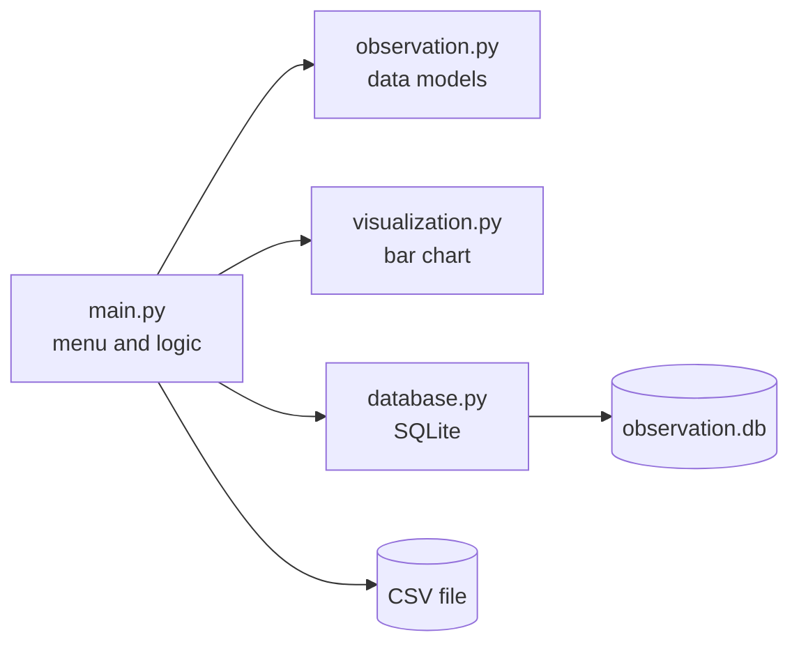
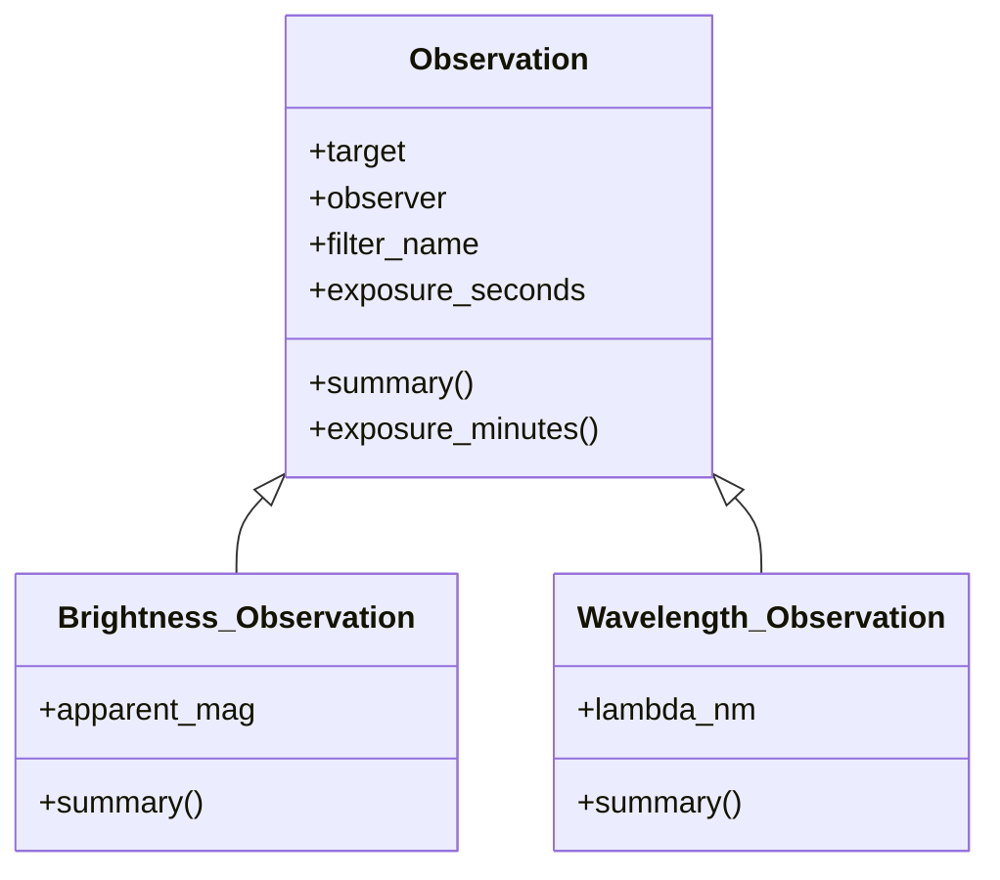

<div align="center">

# 🔭 Skywarden

### A console logbook for astronomical observations

Record what you observed, analyse your exposure times, export your data and chart your nights, all from the terminal.


[Overview](#-overview) ·
[Features](#-features) ·
[Getting started](#-getting-started) ·
[Usage](#-usage) ·
[Architecture](#-architecture) ·
[Data formats](#-data-formats) ·
[Troubleshooting](#-troubleshooting) ·
[Roadmap](#-roadmap)

</div>

---

## 📖 Table of contents

- [Overview](#-overview)
- [Features](#-features)
- [Observation types](#-observation-types)
- [Project structure](#-project-structure)
- [Getting started](#-getting-started)
- [Usage](#-usage)
- [Menu reference](#-menu-reference)
- [Input validation](#-input-validation)
- [Architecture](#-architecture)
- [Data formats](#-data-formats)
- [Troubleshooting](#-troubleshooting)
- [Known limitations](#-known-limitations)
- [Roadmap](#-roadmap)
- [Author](#-author)

---

## ✨ Overview

Astronomers, students and hobbyists all do the same thing after a night under the sky: write down *what* they pointed at, *who* observed, *which filter* was used and *how long* the exposure ran.
**Skywarden** turns that habit into a small, clean Python program.

You add observations through an interactive menu, look at them as a list, calculate exposure statistics, search by target name, then export everything to a **CSV file** or an **SQLite database**, or draw a **bar chart** of exposure times.

The code is deliberately small and readable. It is split into four modules, uses plain classes with inheritance, and relies on only one external package (`matplotlib`).

> **Why this project?** It was built as a Python course project to practise functions, classes and inheritance, input validation, file handling, SQLite, and plotting in one realistic program.

## 🌌 Features

| | Feature | Description |
|---|---|---|
| 🌟 | **Brightness observations** | Target, observer, filter, exposure time and **magnitude** |
| 🌈 | **Wavelength observations** | Target, observer, filter, exposure time and **lambda (nm)**, the wavelength |
| 🛡️ | **Input validation** | Rejects letters, `nan`, `inf`, and zero or negative values where they make no sense |
| 📋 | **Observation list** | Prints every observation with a readable multi-line summary |
| 📊 | **Exposure statistics** | Average, maximum, minimum and total exposure time |
| 🔎 | **Search by target** | Case-insensitive: `vega`, `Vega` and `VEGA` all match |
| 💾 | **CSV export** | One file with `apparent_mag` and `lambda_nm` columns |
| 🗄️ | **SQLite storage** | Saves observations into a local `observation.db` |
| 📈 | **Bar chart** | Target versus exposure time, drawn with Matplotlib |

## 🔬 Observation types

Every observation shares four common fields. Each type adds one more.

| Field | Base `Observation` | `Brightness_Observation` | `Wavelength_Observation` |
|---|:---:|:---:|:---:|
| Target | ✅ | ✅ | ✅ |
| Observer | ✅ | ✅ | ✅ |
| Filter | ✅ | ✅ | ✅ |
| Exposure time (s) | ✅ | ✅ | ✅ |
| Apparent magnitude | | ✅ | |
| Lambda (nm) | | | ✅ |

- **Brightness** observations measure how bright an object is (its photometry), expressed as a *magnitude*. Brighter objects have smaller (even negative) magnitudes, for example Vega is close to `0`.
- **Wavelength** observations record the wavelength in nanometres at which the object was studied. It is stored as `lambda_nm` (λ, "lambda", is the symbol for wavelength).

## 🗂️ Project structure

```text
Skywarden/
├── main.py            # menu loop, input handling, statistics, search, CSV export
├── observation.py     # Observation, Wavelength_Observation, Brightness_Observation
├── database.py        # saves observations into SQLite
├── visualization.py   # Matplotlib bar chart
├── .gitignore         # keeps caches and local data out of the repository
└── README.md
```

| File | Responsibility |
|---|---|
| `main.py` | The program entry point. Shows the menu, reads user input, validates numbers and calls the other modules |
| `observation.py` | Data models. Contains the three classes and their `summary()` methods |
| `database.py` | `save_observations_to_db(observations, connection)` creates the table if needed and inserts rows |
| `visualization.py` | `show_exposure_chart(observations)` draws the bar chart |

## 🚀 Getting started

### Requirements

- **Python 3.10 or newer**
- **matplotlib** (the only external dependency)
- `csv`, `math` and `sqlite3` ship with Python

### Installation

**1. Clone the repository**

```bash
git clone https://github.com/amirmohammadarefkhani1385-creator/Skywarden.git
cd Skywarden
```

**2. (Optional) create a virtual environment**

```bash
python3 -m venv .venv
source .venv/bin/activate        # Linux / macOS
# .venv\Scripts\activate         # Windows
```

**3. Install the dependency**

```bash
pip install matplotlib
```

**4. Run the program**

```bash
python main.py
```

## 🎮 Usage

When the program starts you see the main menu:

```text
========================================

          Welcome to Observer Log

========================================
1. Add Wavelength Observation
2. Add Brightness Observation
3. Show Observation
4. Show Average exposure
5. Show Maximum exposure
6. Show Minimum exposure
7. Show Total exposure
8. Search target
9. Save to a csv file
10. Save to a database
11. Show bar chart for target vs exposure time
12. Exit
Choose:
```

Type a number and press **Enter**. The menu comes back after every action until you choose `12`.

### Example session

**Add a wavelength observation**

```text
Choose: 1
Target: Sirius
Name of observer: Amir
Filter name: R
Exposure time (second): 60
Lambda (nm): 650
Wavelength observation added successfully
```

**Add a brightness observation**

```text
Choose: 2
Target: Vega
Name of observer: Amir
Filter name: V
Exposure time (second): 120
Apparent magnitude: 0.03
Brightness observation added successfully
```

**Show all observations**

```text
Choose: 3

Observation >>> 1
  Target   : Sirius
  Observer : Amir
  Filter   : R
  Exposure : 60 s (1.00 min)
  Lambda: 650 nm

Observation >>> 2
  Target   : Vega
  Observer : Amir
  Filter   : V
  Exposure : 120 s (2.00 min)
  Apparent magnitude: 0.03
```

**Statistics**

```text
Choose: 4
Average exposure time is 90.00 sec

Choose: 5
Maximum exposure time is 120.0 sec
```

**Search**

```text
Choose: 8
Target: vega

Observation found
  Target   : Vega
  Observer : Amir
  Filter   : V
  Exposure : 120 s (2.00 min)
  Apparent magnitude: 0.03
```

**Export**

```text
Choose: 9
Your file name: night1
Data saved successfully
```

This creates `night1.csv` in the folder you ran the program from.

## 🧭 Menu reference

| # | Option | What it does |
|:-:|---|---|
| `1` | Add Wavelength Observation | Asks for target, observer, filter, exposure and lambda |
| `2` | Add Brightness Observation | Asks for target, observer, filter, exposure and apparent magnitude |
| `3` | Show Observation | Prints every stored observation |
| `4` | Show Average exposure | Mean of all exposure times |
| `5` | Show Maximum exposure | Longest exposure |
| `6` | Show Minimum exposure | Shortest exposure |
| `7` | Show Total exposure | Sum of all exposure times |
| `8` | Search target | Finds observations whose target name matches (case-insensitive) |
| `9` | Save to a csv file | Writes all observations to `<name>.csv` |
| `10` | Save to a database | Inserts all observations into `observation.db` |
| `11` | Show bar chart | Opens a Matplotlib window with exposure time per observation |
| `12` | Exit | Closes the database connection and quits |

If you pick a number outside `1` to `12`, the program prints `Please select 1 to 12` and shows the menu again.
If there is nothing to show yet, actions `3` to `11` print `No observation found` instead of failing.

## 🛡️ Input validation

Every number is read by one small helper, `get_number(prompt, positive=True)`, so all numeric fields are checked in the same way.

| Field | Accepted values | Rejected |
|---|---|---|
| Exposure time | Any finite number **greater than 0** | letters, `0`, negative numbers, `nan`, `inf` |
| Lambda (nm) | Any finite number **greater than 0** | letters, `0`, negative numbers, `nan`, `inf` |
| Apparent magnitude | Any **finite** number, negative values allowed | letters, `nan`, `inf` |

When a value is invalid, the program prints a short message and **returns to the menu** without saving anything, so a wrong entry never ends up in the log.

```text
Choose: 1
Target: Sirius
Name of observer: Amir
Filter name: R
Exposure time (second): abc
Value should be an integer or float number
```

## 🧬 Architecture

### Module relationships



### Class hierarchy



`Brightness_Observation` and `Wavelength_Observation` **inherit** from `Observation`.
They call `super().__init__()` for the shared fields and **override** `summary()` to append their own line, so the rest of the program can treat every observation the same way (`obs.summary()`) without checking its type.

### Main functions in `main.py`

| Function | Purpose |
|---|---|
| `get_number(prompt, positive=True)` | Reads a finite number; returns `None` (and prints a message) if the input is invalid |
| `add_wavelength_observation()` | Collects the data for a wavelength observation |
| `add_brightness_observation()` | Collects the data for a brightness observation |
| `show_observation()` | Prints all observations |
| `statistical_analysis(average, maximum, minimum, total)` | Prints the chosen exposure statistic |
| `search_observation()` | Searches by target name |
| `save_to_csv_file()` | Exports observations to CSV |

## 💾 Data formats

### CSV export

One row per observation. `apparent_mag` is only filled for brightness rows and `lambda_nm` only for wavelength rows.

```csv
target,observer,filter,exposure_seconds,apparent_mag,lambda_nm
Sirius,Amir,R,60.0,,650.0
Vega,Amir,V,120.0,0.03,
```

### SQLite database

Saved in `observation.db` in the folder you run the program from. The table is created automatically on the first save.

| Column | Type | Note |
|---|---|---|
| `id` | `INTEGER PRIMARY KEY AUTOINCREMENT` | Generated automatically |
| `target` | `TEXT` | |
| `observer` | `TEXT` | |
| `filter_name` | `TEXT` | |
| `exposure_seconds` | `REAL` | |

You can inspect the data with the SQLite command line:

```bash
sqlite3 observation.db "SELECT * FROM observations;"
```

### Bar chart

Option `11` plots one bar per observation: the target name on the x-axis and exposure time in seconds on the y-axis, with the value written above each bar.

## 🩺 Troubleshooting

| Problem | Likely cause | Fix |
|---|---|---|
| `ModuleNotFoundError: No module named 'observation'` | File names or imports do not match, or you are not in the project folder | Use lowercase names (`observation.py`) and run `python main.py` from inside the project folder |
| `ModuleNotFoundError: No module named 'matplotlib'` | The dependency is not installed | `pip install matplotlib` |
| `TypeError: ... takes no arguments` | The constructor is misspelled | In `observation.py` it must be `__init__` with **two underscores on each side** |
| Works in Jupyter but not in the terminal | Notebooks cannot be imported like `.py` files | Keep the code in `.py` files, not `.ipynb` |
| An old version of a class is still used in Jupyter | The kernel cached the earlier import | `Kernel` ▸ `Restart Kernel` |
| The chart window does not appear | No display available, for example over SSH | Run on a machine with a desktop, or save the figure with `plt.savefig(...)` |
| `Please select 1 to 12` | The input was not one of the menu numbers | Type only the number, without spaces or letters |

## ⚠️ Known limitations

- **Observations live in memory.** If you close the program without saving to CSV or the database, they are lost.
- **Saving twice duplicates rows.** Option `10` inserts every observation again each time it is chosen.
- **The database stores four columns.** Apparent magnitude and lambda are saved in the CSV export, but not yet in `observation.db`.
- **The chart shows one bar per observation**, not a sum per target.
- **No loading step.** Data exported to CSV or SQLite cannot yet be read back into the program.

## 🛣️ Roadmap

- [ ] Store apparent magnitude and lambda in the database
- [ ] Load observations from CSV or the database on start-up
- [ ] Avoid duplicate rows when saving to the database repeatedly
- [ ] Sum exposure time per target in the chart
- [ ] Edit and delete observations
- [ ] Unit tests for the validation helper and the classes
- [ ] Date and time of each observation

## 👤 Author

Made by [**amirmohammadarefkhani1385-creator**](https://github.com/amirmohammadarefkhani1385-creator)

If you find a bug or have an idea, feel free to open an issue.

<div align="center">

*Clear skies, and happy observing* ✨

</div>
