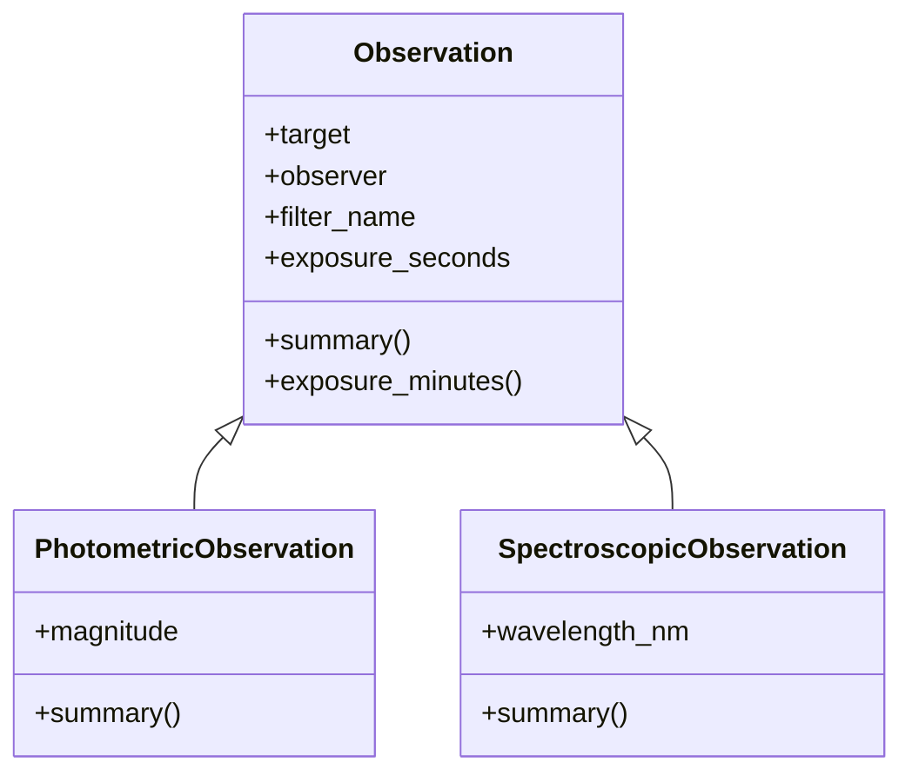

<div align="center">

# 🔭 Skywarden

**A console logbook for astronomical observations.**
Record, search, analyse and chart your nights under the sky, straight from the terminal.


</div>

---

## ✨ Overview

Skywarden is a small, dependency-light program that keeps track of what you observed, with which filter, for how long, and what you measured.
It supports two kinds of observations, built with simple object-oriented classes, and can export your data to **CSV** or **SQLite** and plot exposure times as a **bar chart**.

```text
========================================

          Welcome to Observer Log

========================================
 1. Add Photometric Observation
 2. Add Spectroscopic Observation
 3. Show Observation
 4. Show Average exposure
 5. Show Maximum exposure
 6. Show Minimum exposure
 7. Show Total exposure
 8. Search target
 9. Save to a csv file
10. Save to a database
11. Show bar chart for target vs exposure time
12. Exit
```

## 🌌 Features

| | Feature | Description |
|---|---|---|
| 🌟 | **Photometric observations** | Target, observer, filter, exposure time and magnitude |
| 🌈 | **Spectroscopic observations** | Target, observer, filter, exposure time and wavelength (nm) |
| 🛡️ | **Input validation** | Rejects letters, `nan`, `inf`, zero and negative values where they make no sense |
| 📊 | **Exposure statistics** | Average, maximum, minimum and total exposure time |
| 🔎 | **Search** | Find observations by target name, case-insensitive |
| 💾 | **CSV export** | One file with magnitude and wavelength columns |
| 🗄️ | **SQLite storage** | Save the session to `observation.db` |
| 📈 | **Bar chart** | Target vs exposure time with Matplotlib |

## 🧬 How it fits together



## 🗂️ Project structure

```text
Skywarden/
├── main.py            # menu, input handling, statistics, search, CSV export
├── observation.py     # Observation, PhotometricObservation, SpectroscopicObservation
├── database.py        # SQLite saving
├── visualization.py   # Matplotlib bar chart
└── README.md
```

## 🚀 Getting started

**1. Clone the repository**

```bash
git clone https://github.com/amirmohammadarefkhani1385-creator/Skywarden.git
cd Skywarden
```

**2. Install the only external dependency**

```bash
pip install matplotlib
```

**3. Run**

```bash
python main.py
```

> Python 3.10 or newer is recommended. `csv`, `math` and `sqlite3` ship with Python.

## 🛰️ Example session

```text
Choose: 1
Target: Vega
Name of observer: Amir
Filter name: V
Exposure time (second): 120
Magnitude: 0.03
Photometric observation added Succesfully

Choose: 3

Observation >>> 1
  Target   : Vega
  Observer : Amir
  Filter   : V
  Exposure : 120 s (2.00 min)
  Magnitude: 0.03
```

## 💾 Where your data goes

| Option | Output | Contents |
|---|---|---|
| `9` CSV | `<your name>.csv` | target, observer, filter, exposure, magnitude, wavelength |
| `10` Database | `observation.db` | table `observations`: target, observer, filter, exposure |
| `11` Chart | window | bar chart of exposure time per target |

## 🧰 Built with

- **Python**: core logic and classes
- **Matplotlib**: visualisation
- **SQLite**: local database
- **csv / math**: file export and number validation

## 👤 Author

Made by [**amirmohammadarefkhani1385-creator**](https://github.com/amirmohammadarefkhani1385-creator)

<div align="center">

*Clear skies* ✨

</div>
